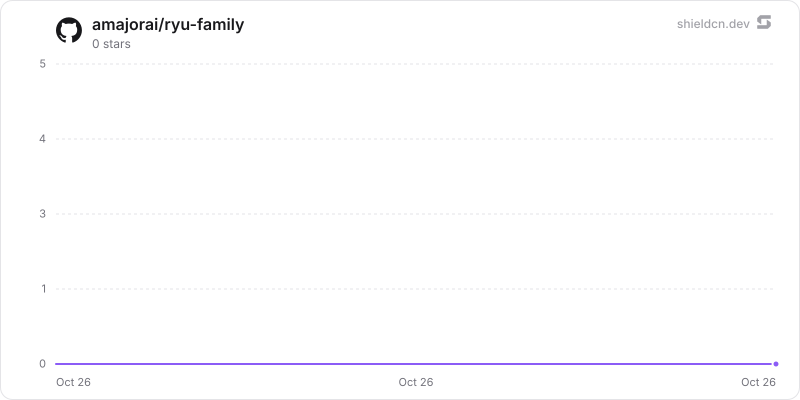

<div align="center">

# family

</div>

A shared family hub: important dates with reminders, shared lists and chores, wishlists, and gift ideas kept from the person they are for, with an agent, Companion, and MCP tools over one SQLite store.

> **The public home of `ryu-family`.** Source, builds, and releases live here —
> binaries for every platform are attached to each release.
>
> This tree is generated from the Ryu monorepo, so commits pushed here
> directly are replaced on the next sync. **Pull requests are welcome** —
> open them here and they are ported into the monorepo, then flow back out.
> Ryu as a whole: https://github.com/amajorai/ryu

## Install

**App:** [Install](ryu://apps/com.ryu.family) (opens the Ryu desktop app and asks you to confirm)

**CLI:**

```bash
ryu apps add com.ryu.family
```

**From source:**

```bash
cargo build --release --manifest-path backend/Cargo.toml
```

Prebuilt binaries for every platform are attached to [each release](https://github.com/amajorai/ryu/releases).

## License

Apache-2.0 — see [LICENSE](./LICENSE).

## Use it

- Install the **Family** app to get the Family Planner agent runnable, the
  companion, and the daily reminder sweep together. The companion has six
  views, opened from the sidebar: Upcoming, People & dates, Lists, Wishlists,
  Gift ideas, and Settings.
- Install the standalone **Family Planner** Marketplace agent first, then add
  the Family app. The template declares `@ryu/family` as its required data
  provider; it does not keep a second copy of the family's records.
- The node your family uses keeps the records. On a family organization's
  shared node, members reach the hub through that node; personal nodes do not
  sync it.
- **Organizer setup on a shared node.** App routes are checked against each
  member's permissions, and app-declared levels are denied to every role until
  granted. An organizer must grant `family.view` and `family.edit` (and
  `family.manage` to whoever should change the hub's settings) to the members
  who should use the hub, on the `@ryu/family` resource.

## Agent tools

The sidecar's MCP server is registered as `family` and exposes:

- `family.upcoming`
- `family.people_list`, `family.person_upsert`
- `family.dates_list`, `family.date_upsert`, `family.date_delete`
- `family.lists_get`, `family.list_create`, `family.list_add_items`,
  `family.list_check`, `family.list_assign`, `family.list_remove_item`
- `family.chores_tally`
- `family.prefs_get`, `family.prefs_set`
- `family.wishlist_get`, `family.wishlist_add`
- `family.gift_context`

The agent's allowlist is exactly `family` and `web.search`. It has no purchase,
checkout, payment, or browser-automation tools, and its instructions forbid
buying anything: it suggests gifts as links and price ranges within a budget.

Core forwards no verified caller into a stdio MCP call, so the tools run as an
unverified shared caller that may be anyone, including the person a surprise is
for. They therefore never read or write gift ideas or wishlist claims, never
see private rows or any sensitive preference (even one its person shared with
the family), write only family-visible rows, and cannot delete people or lists
or change settings. Saving a gift idea or claiming a wishlist item happens in
the companion. The tools serve the one family that turned on **Family agent
access** in Settings; until then they answer `agent_not_connected`. Agent
access starts off for every family, a family cannot take it while another
family on the node holds it, and the first request of a family organization
drops access still held by the node's earlier personal tenant (`local` or
`user:`), so an organization's agents are never served a personal hub. Every
agent on the node reaches that one family's data, so only turn it on for the
family the node belongs to.

The companion calls the store through the generic own-app bridge. It never
receives a node token or makes a direct network request.

## Data and privacy rules

Every row carries its tenant, its creator, and a `family` or `private`
visibility. One authorization module decides every read and write, and the
HTTP routes, the MCP tools, and the reminder sweep all go through it.

- **Tenancy.** The tenant and acting member come only from the verified
  headers Core injects on the ext-proxy hop: `org:<id>` for a family
  organization, `user:<id>` for a single member, and `local` on an unmanaged
  single-user node. A request with no verified caller fails closed on a managed
  node. Body, query, and tool arguments never choose a tenant or user.
- **Private rows** are visible only to their owners; nobody edits another
  member's private row. Only a row's creator can make it private (a private
  preference or wishlist item is also visible to the person it is about, when
  they were linked as it was written). A private person makes their dates,
  preferences, wishlist, and gift ideas private too.
- **Gift ideas** are invisible to the person they are for on every path: lists,
  edits, deletes, gift context, counts, and reminders. A member cannot keep an
  idea for themselves.
- **Wishlist claims** are never shown to the wishlist's own person. Others see
  only whether an item is claimed and whether they claimed it, never who did.
  Claiming never changes the item's `updatedAt`. Only an item's creator and
  the wishlist's person can edit it.
- **"This is me."** A member links their account to a family person once. There
  is no unlink, so a member cannot reveal their own surprises. A duplicate,
  unlinked row for the same person is not protected. Linking is not verified,
  so it never hands over what others wrote before it: a preference or wishlist
  item written before the link stays its creator's (it records the member the
  person was linked to when it was written). The linked member cannot delete
  their own person, because the delete would wipe gift ideas and claims kept
  from them; the person's creator can.
- **Sensitive preferences** (health, allergies, and similar) default to private.
  Only the person, or the creator when the row predates the person's link (a
  guardian proxy), can share one with the family.
- **Reminders** arrive in the Ryu inbox and as push notifications, at the
  family's reminder hour on the occasion's local day (Feb 29 is observed on
  Mar 1 in other years) and on each lead day. Each reminder is claimed as
  pending before it is sent and marked sent after Core accepts it, so it goes
  out once; a claim left pending by a process that died mid-delivery is taken
  over after a one-minute lease on the same day. Moving a date's month or day
  clears its claims so the corrected day still reminds. A birthday never reminds its own person, muted
  members are skipped, and the person an occasion is for never hears about
  gifts; other members get at most a count of the gift ideas they can see.
  Recipients are the members linked to a family person plus everyone who has
  written to the hub, because the kernel exposes no member roster.
- **Email reminders are not available.** Core reserves email delivery for the
  Mail app.
- **Chore points** are a simple tally. No money moves.
- **Audit.** Every write appends an actor, action, table, and row id (never
  values) to an append-only audit table. There is no read endpoint yet, because
  no role reaches the sidecar.

## Local sidecar

The process is `ryu-family`; `ryu-family mcp` serves the MCP tools. Core
supplies its data directory, port, callback port, and token when the app is
enabled, and runs it continuously so the reminder sweep keeps its schedule. For
an isolated standalone development run:

```sh
RYU_PROFILE=dev RYU_KEYCHAIN=off RYU_DIR=/tmp/ryu-family-dev \
  cargo run -p ryu-family
```

Without Core's callback settings the sweep claims nothing, so a standalone run
never marks reminders as sent.

## At rest

`family.db` seals free text per value (`encb:v1:`, store `family.db`, each value bound to its
table, column and row id) under the `@ryu/family` plugin subkey Core delivers to the sidecar
(`crypto:seal` in the sidecar's `host_api.grants`): people's `display_name` and
`relationship`, date `label`, list `name`, list item `text` and `qty`, preference `key` and
`value` (every row, sensitive or not), wishlist `title`, `url` and `price_hint`, and gift idea
`idea`, `url` and `occasion`. Writes seal through the `ryu_seal` SQL function and reads open
through `ryu_open` (`src/seal_sql.rs`), so plaintext is never stored. Tenants, visibility,
member links, date `month`/`day`/`year`, lead times, statuses, points, budgets, ids and
timestamps stay plaintext: the reminder sweep and the tenant and visibility rules read them.
People and preferences are sorted by name and key after opening; the old
`(tenant, display_name)` index is dropped. Legacy plaintext rows are sealed when the store
opens (resumable, idempotent; a sealed column that still holds plaintext is walked again), then
the WAL is truncated and freed pages are zeroed (`secure_delete` is on for every connection). A
row that does not open is left out of lists and counted (`/health`
`sealing.unreadable_rows`). Accepted residual: a date reminder's title names the person and
the date label ("Ana's birthday is tomorrow"), because a nameless reminder is not useful, and
Core's notification inbox (`notify.db`) is not encrypted, so every delivered reminder keeps a
readable copy of that name and label there. Key states (`backend/src/seal_keys.rs`):

- **Compat mode**: under an older Core that delivers no key, a never-sealed store keeps working
  in plaintext and `/health` reports `sealing.state = "compat"` ("waiting for a Ryu update").
- **No key or another key for a sealed store**: `sealing.state = "unhealthy"`, writes are
  refused and the data is kept.
- **Standalone** (no `RYU_PLUGIN_DATA_DIR`): `RYU_MASTER_KEY` if set, else a generated root in
  `<plugin data dir>/secrets/standalone-root.key` (0600) whose key check value is pinned.
- **`ryu-family mcp`** gets no key (Core delivers keys to sidecars only). It runs every tool
  inside the running sidecar (`ryu_sidecar_runtime::handoff`, re-exported as
  `src/sidecar_link.rs`): at start the sidecar writes
  `<plugin data dir>/secrets/sidecar-handoff.json` (0600) with its loopback port and a random
  token minted for that run (never the Core ext token; replaced at every start, removed on
  shutdown). That token opens only `POST /_handoff/mcp/call`, outside the Core-proxied mount,
  which runs the same tool code with the same agent caller. When no sidecar answers, the MCP
  process uses the store itself and never generates a standalone root; before each tool it
  re-checks the store and refuses once the sidecar has sealed it.

The standalone satellite mirror builds `ryu-crypto` from crates.io at the declared version, so
the release train that ships this must publish `ryu-crypto` first (already ordered before app
backends in `tools/publish-crates.sh`).

## Star History

<a href="https://github.com/amajorai/ryu-family/stargazers">
  <picture>
    <source media="(prefers-color-scheme: dark)" srcset="./.github/shieldcn/star-chart-dark.svg" />
    
  </picture>
</a>
